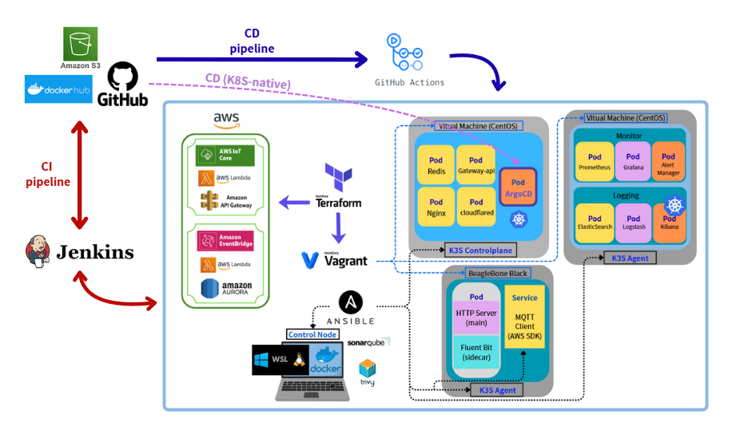

# DevSecOps_with_BBB

A hybrid edge-to-cloud DevOps architecture integrating K3s, Jenkins, ArgoCD, Terraform, Ansible, and AWS IoT Core.

## 📘 Overview

This project demonstrates an end-to-end DevSecOps workflow connecting edge devices (BeagleBone Black) with cloud infrastructure. It covers CI/CD, automated provisioning and deployment, monitoring, logging, and security controls.

---

## 🧱 Architecture

### 🔹 Components

- **CI/CD:** Jenkins + GitHub Actions + ArgoCD
- **Infrastructure:** Terraform + Ansible + Vagrant
- **Monitoring:** Prometheus + Grafana + AlertManager
- **Logging:** Fluent Bit + Logstash + Elasticsearch + Kibana
- **Edge Device:** BeagleBone Black (K3s agent + HTTP server + AWS MQTT client)
- **Cloud Services:** Cloudflare Tunnel, AWS Lambda, API Gateway, EventBridge, IoT Core, Aurora Serverless, S3
- **Security:** SonarQube + Trivy + OIDC

---

#### 🏗️ Infrastructure

- **Terraform + Ansible + Vagrant:** Automate infrastructure provisioning and environment configuration.
- **K3s Cluster:** Provide a lightweight Kubernetes environment for deploying applications and the monitoring stack.

#### ⚙️ CI/CD & GitOps

- **Jenkins:** Handles the **CI stage**, including automated builds and tests, and produces deployable artifacts. After tests pass, it opens a pull request against the **CD repository** to initiate deployment review.
- **GitHub Actions:** Handles the **CD stage**. Once the pull request is reviewed and merged, the corresponding workflow provisions infrastructure and deploys applications.
- **ArgoCD:** Implements **GitOps-based** synchronization and version control on Kubernetes, keeping the cluster's desired state aligned with the Git repository.

#### 🧩 Web / Application Layer

- **Go-based HTTP Server:** Runs as the primary application Pod on the BeagleBone Black, exposes RESTful APIs to external clients, and interacts with the cluster through the Kubernetes API.

> 📎 The HTTP server authenticates to the in-cluster API using a mounted ServiceAccount token, enabling authenticated read access to Pod and Node resources.

- **Nginx (HTTPS Upstream Proxy):** Bridges protocol differences by forwarding traffic received through a Gateway API **HTTPRoute** to backends that require **HTTPS**.

> 💡 Note: The Gateway API implementation used in this project did not support the required HTTPS upstream configuration. Nginx acts as a bridging proxy for internal services such as Elasticsearch.

- **Redis (In-memory Cache):** Reduces repeated queries and improves HTTP server response times.
- **Cloudflare Tunnel (Secure Ingress):** Provides a secure entry point for exposing selected services within the K3s cluster—such as ArgoCD, Grafana, Kibana, and the HTTP server—to the internet.

#### 🔸 IoT Communication

- **AWS IoT Core:** Receives MQTT messages and authenticates device identities.
- **AWS Lambda (IoT Publisher):** Triggered by API Gateway, transforms incoming requests into control commands, and publishes them to AWS IoT Core topics to control edge-device behavior.
- **API Gateway:** Exposes an external HTTP interface through which clients issue REST requests; Lambda converts those requests into MQTT messages.

#### 🔸 Data Processing for the Web / HTTP Server

- **AWS Lambda (Data Processor):** Queries Elasticsearch for edge-device log and monitoring data, processes the results, and stores them in Aurora Serverless for historical queries and further analysis.
- **Amazon EventBridge (Scheduler):** Invokes the data-processing Lambda every five minutes to synchronize edge-device information.
- **Amazon Aurora Serverless (MySQL):** Stores processed status records and historical data.
- **Amazon S3 (Artifact Storage):** Stores application and firmware artifacts produced by Jenkins for deployment and version tracking.

#### 📊 Monitoring & Logging

- **Prometheus + Grafana + AlertManager:** Collect and visualize infrastructure and application metrics, with email notifications for alerts.
- **Fluent Bit + ELK Stack:** Provide centralized log collection, processing, storage, and search.
